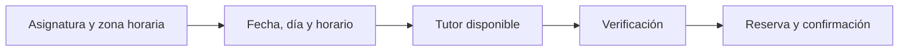

# QA funcional | Agendamiento de clases

**Caso de estudio anonimizado · Enero de 2026 · Angela Maria Soplin Costa**

¿Cómo comprobar que una persona puede reservar una clase en una fecha válida y con un tutor disponible? En este proyecto diseñé y ejecuté pruebas manuales sobre el flujo de agendamiento de una plataforma educativa. Registré resultados, hallazgos funcionales y observaciones sobre la experiencia de usuario.

| Mi participación | Enfoque | Evidencia |
|---|---|---|
| Diseño y ejecución de pruebas y documentación de hallazgos | QA manual, reglas de negocio, escenarios Given / When / Then y UX | Plan, matriz de casos y reportes anonimizados |

## El flujo evaluado

El escenario principal quedó registrado como **PASS**: la sesión se creó y se mostró una confirmación.

## Qué encontré

La matriz original registra **cinco escenarios FAIL**: dos sobre disponibilidad del tutor, uno sobre selección de tutor y dos sobre coherencia de fechas u horas. Las dos fallas de disponibilidad podrían tener una causa común; no hay evidencia suficiente para afirmarlo. Los resultados corresponden a enero de 2026 y no acreditan el estado actual ni la corrección de las fallas.

Por ejemplo, al intentar reservar un horario ya asignado, el resultado esperado era bloquear la operación e informar la falta de disponibilidad. La matriz registra que se creó la sesión y se mostró un mensaje de éxito. El impacto potencial sería el solapamiento de sesiones.

También documenté observaciones de UX sobre la claridad de AM/PM y los mensajes de validación en diferentes navegadores. La matriz no asignó severidad formal a los hallazgos.

## Mi proceso

1. Definir el objetivo, alcance, riesgos y reglas de negocio.
2. Diseñar escenarios positivos y negativos y criterios esperados.
3. Ejecutar pruebas manuales y registrar resultado esperado y observado.
4. Documentar fallas y observaciones de usabilidad.

El plan contempló Chrome, Firefox y Safari; los documentos detallan las observaciones por navegador cuando la matriz original las registra. La integración con calendario externo se consideró para una fase posterior y no se presenta como validada.

## Explorar la documentación

- [Plan de pruebas](plan-de-pruebas.md): objetivo, alcance, reglas y riesgos.
- [Casos y trazabilidad](casos-de-prueba.md): escenarios, resultados y relación con hallazgos.
- [Reportes de defectos](reporte-de-defectos.md): condiciones, pasos disponibles e impacto potencial.
- [Escenarios Gherkin](escenarios.feature): descripción de escenarios de prueba manual.
- [Texto para portafolio y CV](presentacion-portafolio.md).

## Sobre la evidencia

Versión anonimizada y adaptada de documentos de trabajo; no incluye la aplicación, capturas ni datos de usuarios. Los escenarios Gherkin son documentación, no pruebas automatizadas. No es posible reproducir las pruebas originales desde este repositorio. Los detalles incompletos y ambiguos están señalados en los documentos.
